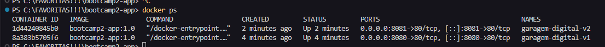

# Garagem Digital

## Autor

Bruna Martins Moura  
Matrícula: 22650015  
Instituição: CEUB  
Disciplina: Bootcamp II

## Descrição do projeto

A Garagem Digital é uma aplicação web que permite explorar marcas e modelos de carros disponíveis no mercado brasileiro de forma simples, organizada e interativa.

A aplicação utiliza a BrasilAPI para consultar informações da Tabela FIPE, permitindo visualizar modelos conhecidos, versões disponíveis e códigos de referência.

Também oferece consulta de valores FIPE e imagens ilustrativas dos veículos.

Na Etapa 02 do Bootcamp II, o projeto foi ampliado com persistência de dados utilizando Firebase Firestore e conteinerização com Docker e Nginx.

## Funcionalidades

- Selecionar marcas de veículos.
- Consultar modelos utilizando a BrasilAPI.
- Visualizar versões disponíveis na Tabela FIPE.
- Consultar valores FIPE por versão e ano.
- Visualizar códigos de referência.
- Buscar imagens ilustrativas no Wikimedia Commons.
- Adicionar carros aos favoritos.
- Listar os veículos favoritos.
- Excluir veículos da lista de favoritos.
- Manter os favoritos salvos após fechar e reabrir o navegador.
- Executar a aplicação em containers Docker.
- Utilizar uma interface responsiva.

## Tecnologias utilizadas

- HTML5
- CSS3
- JavaScript
- Fetch API
- BrasilAPI
- Wikimedia Commons API
- API FIPE Parallelum
- Firebase Authentication
- Firebase Firestore
- Docker
- Nginx
- Git e GitHub
- GitHub Pages

## APIs utilizadas

### BrasilAPI

Documentação: https://brasilapi.com.br/docs

Lista de marcas:

https://brasilapi.com.br/api/fipe/marcas/v1/carros

Lista de veículos:

https://brasilapi.com.br/api/fipe/veiculos/v1/carros/{codigoMarca}

### API FIPE Parallelum

Utilizada para consultar os anos disponíveis e os valores FIPE de versões específicas.

https://fipe.parallelum.com.br/

### Wikimedia Commons

Utilizada para consultar imagens ilustrativas dos veículos.

https://commons.wikimedia.org/

## Persistência de dados — Firebase Firestore

Na Etapa 02, foi implementada a persistência dos carros favoritos utilizando o Firebase Firestore, um banco de dados NoSQL em nuvem.

O Firebase foi escolhido por permitir a integração com aplicações JavaScript sem a necessidade de desenvolver um backend próprio.

### Estrutura dos dados

Os favoritos são armazenados utilizando a seguinte estrutura:

usuarios/
  {userId}/
    favoritos/
      {favoritoId}/
        marca
        modelo
        criadoEm

Cada documento contém:

- marca: fabricante do veículo.
- modelo: nome do modelo escolhido.
- criadoEm: data e horário de criação do registro.

### Operações implementadas

CREATE: adiciona um veículo aos favoritos.

READ: consulta e apresenta os veículos salvos.

DELETE: remove um veículo da lista de favoritos.

As operações são realizadas diretamente no Firestore.

### Autenticação e segurança

A aplicação utiliza Firebase Authentication com autenticação anônima.

Cada visitante recebe um identificador único, utilizado para organizar seus favoritos.

As regras de segurança do Firestore restringem o acesso aos favoritos do próprio usuário autenticado.

### Teste de persistência

Foi realizado um teste adicionando um veículo aos favoritos, fechando o navegador e acessando novamente a aplicação.

O veículo permaneceu salvo, demonstrando o funcionamento da persistência no banco de dados.

A exclusão de favoritos também é disponibilizada pela interface.

### Limitação conhecida

A autenticação anônima não permite recuperar automaticamente os mesmos favoritos em outro navegador ou dispositivo.

A remoção dos dados de autenticação do navegador também pode causar a perda de acesso à lista anterior.

## Conteinerização com Docker

A aplicação utiliza Docker para disponibilizar o site em um ambiente padronizado.

Foi utilizado o Nginx como servidor web, por meio da imagem base nginx:alpine.

O Dockerfile copia os arquivos HTML, CSS e JavaScript para o diretório servido pelo Nginx.

### Construir a imagem

docker build -t bootcamp2-app:1.0 .

### Executar a aplicação

docker run -d -p 8080:80 --name garagem-digital brureads/bootcamp2-app:1.0

Após executar o comando, acessar:

http://localhost:8080

### Repositório Docker Hub

https://hub.docker.com/r/brureads/bootcamp2-app

### Versionamento das imagens

As tags previstas para a entrega são:

- 1.0: primeira versão funcional conteinerizada.
- 1.1: versão posterior com melhoria documentada.
- latest: identificação da versão mais recente.

## Sidequest 1 — .dockerignore

Foi criado o arquivo .dockerignore para evitar o envio de arquivos desnecessários ao contexto de construção da imagem Docker.

Exemplos de arquivos que podem ser ignorados:

- Diretório .git
- Arquivos temporários
- Documentos não necessários à execução
- Arquivos locais do ambiente de desenvolvimento

Isso reduz o contexto enviado ao Docker e pode tornar o processo de construção mais rápido e eficiente.

## Sidequest 2 — Versionamento Docker

O projeto utiliza versionamento de imagens Docker por meio de tags.

A versão 1.0 representa a primeira versão funcional publicada.

As versões 1.1 e latest serão publicadas após a conclusão da melhoria técnica prevista para a segunda versão.

As tags permitem identificar versões específicas e controlar a distribuição da aplicação.

## Sidequest 3 — Descrição no Docker Hub

O repositório da aplicação no Docker Hub possui uma apresentação contendo:

- Descrição do projeto.
- Funcionalidades principais.
- Comando para executar a aplicação.
- Link do código-fonte no GitHub.

Repositório:

https://hub.docker.com/r/brureads/bootcamp2-app

## Sidequest 4 — Dois containers simultâneos

Foram executados dois containers da aplicação simultaneamente, utilizando portas diferentes.

Container 1:

docker run -d -p 8080:80 --name garagem-digital-v1 bootcamp2-app:1.0

Container 2:

docker run -d -p 8081:80 --name garagem-digital-v2 bootcamp2-app:1.0

Para verificar os containers:

docker ps

Os dois containers foram executados com sucesso, permitindo acessar a aplicação nas portas 8080 e 8081.

### Evidência

## Kubernetes e orquestração

Se fosse necessário administrar 100 containers, executar comandos Docker individualmente seria pouco eficiente.

Uma solução seria utilizar o Kubernetes, uma plataforma de orquestração de containers.

O Kubernetes permite distribuir aplicações entre máquinas, acompanhar sua execução e gerenciar réplicas.

Um cluster é um conjunto de máquinas utilizadas para executar aplicações conteinerizadas.

Um pod é a menor unidade de execução gerenciada pelo Kubernetes e pode conter um ou mais containers.

As réplicas permitem manter várias instâncias de uma aplicação funcionando simultaneamente.

Dessa forma, se uma instância apresentar problemas, o Kubernetes pode criar outra para manter a quantidade desejada de réplicas.

O Kubernetes também facilita a distribuição de cargas de trabalho e a atualização de aplicações.

## Como executar localmente

Clone o repositório:

git clone https://github.com/brureads/garagem-digital.git

Entre na pasta do projeto e abra utilizando um servidor HTTP local, como o Live Server do Visual Studio Code.

Também é possível executar a aplicação utilizando Docker.

Para o funcionamento dos favoritos, são necessárias as configurações do Firebase Authentication e do Firestore, incluindo as regras de segurança.

## Repositórios e links

GitHub:

https://github.com/brureads/garagem-digital

GitHub Pages:

https://brureads.github.io/garagem-digital/

Docker Hub:

https://hub.docker.com/r/brureads/bootcamp2-app

## Conclusão

Na Etapa 02 do Bootcamp II, a Garagem Digital evoluiu de uma aplicação de consulta de veículos para uma aplicação com persistência de dados em nuvem.

A integração com Firebase Firestore permitiu salvar e recuperar os veículos favoritos.

A utilização do Docker e do Nginx possibilitou executar a aplicação em containers, demonstrando conceitos de portabilidade, conteinerização e distribuição de software.

O projeto também proporcionou experiência prática com Git, GitHub, versionamento de imagens Docker e conceitos introdutórios de orquestração com Kubernetes.
